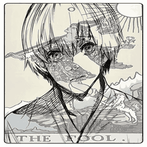

# sLaZer

**Gamer · RL player · Roblox Developer**

---

## 🔗 Links

- 🌐 Portfolio: [slazer.pages.dev](https://slazer.pages.dev)
- 📸 Instagram: [@k2nly](https://www.instagram.com/k2nly)
- 🎵 TikTok: [@slazer.1](https://www.tiktok.com/@slazer.1)
- ▶️ YouTube: [@sLaZer-H](https://www.youtube.com/@sLaZer-H)
- 💬 Discord: [Join the server](https://discord.gg/DhvU5ZxfTF)
- 🧱 Roblox: [Profile](https://www.roblox.com/users/8978327534/profile)

## 📁 About this repo

Source code of my personal portfolio page, built with plain HTML, CSS and JavaScript (no frameworks) and hosted on Cloudflare Pages.

Code source mta3 portfolio perso mte3i, ma3moul b HTML CSS JS bla frameworks, w hébergé fi Cloudflare Pages.
